<picture>
  <source media="(prefers-reduced-motion: reduce)" srcset="assets/hero-static.svg">
  
</picture>

  <picture>
    <source media="(prefers-reduced-motion: reduce)" srcset="assets/typing-static.svg">
    
  </picture>

  
  &nbsp;
  
  &nbsp;
  

  I’m <strong>Faraz</strong>, a developer and product builder in <strong>Turin, Italy</strong>. 
  Industrial interfaces by day. Independent experiments whenever an idea won’t leave me alone. 
  I care about the system underneath, the interaction on top, and the details in between.

  <a href="#professional-work">Professional work</a> &nbsp; / &nbsp;
  <a href="#independent-projects">Projects</a> &nbsp; / &nbsp;
  <a href="#ship-log">Ship log</a> &nbsp; / &nbsp;
  <a href="#toolkit">Toolkit</a> &nbsp; / &nbsp;
  <a href="#public-activity">Activity</a>

<picture>
  <source media="(prefers-color-scheme: dark)" srcset="assets/section-professional.svg">
  
</picture>

<table>
<tr>
<td width="50%" valign="top">
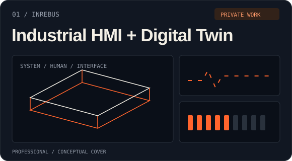
<h3>Industrial HMI / Digital Twin</h3>

Making complex industrial systems understandable through human–machine interfaces and technical visualization.

<strong>Interface engineering · Interaction · Systems</strong>

inRebus · Professional · Private repository

</td>
<td width="50%" valign="top">
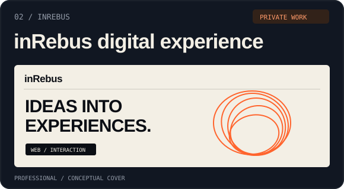
<h3>inRebus / Digital experience</h3>

Developing the company’s web experience through responsive interfaces, visual identity and purposeful motion.

<strong>React · TypeScript · Vite · GSAP</strong>

inRebus · Professional · Private repository

</td>
</tr>
</table>

Professional covers are original abstract artwork. Implementation details and source code remain private.

<picture>
  <source media="(prefers-color-scheme: dark)" srcset="assets/section-projects.svg">
  
</picture>

  <strong>HamiYami</strong> is a marketplace demo for meals cooked by neighbourhood cooks: a weekly menu grouped by pickup day, simulated reservations with pickup codes and calendar export, a cook workspace with a day-by-day prep view, and a scrollytelling story page. Italian and English. Every meal, cook and number in it is fictional, and the demo says so.

  Next.js 16 · React 19 · TypeScript · Zod · Vitest · Playwright · Cloudflare Workers &nbsp;/&nbsp; 117 unit tests · 51 browser tests 
  <a href="https://hamiyami.com"><strong>Open hamiyami.com ↗</strong></a> &nbsp; · &nbsp; <a href="https://github.com/Farazhaghgoo/hamiYami"><strong>Explore the code ↗</strong></a>

<table>
<tr>
<td width="50%" valign="top">
<a href="https://github.com/Farazhaghgoo/curseek"></a>

Hide-and-seek for mouse cursors in a dark maze. Server-run rooms over WebSocket, predicted movement, wall-clipped light, perks and curses, bots for solo play.

TypeScript · Node.js · WebSocket · esbuild · Docker

<a href="https://github.com/Farazhaghgoo/curseek"><strong>Explore curseek ↗</strong></a>
</td>
<td width="50%" valign="top">
<a href="https://github.com/Farazhaghgoo/portfolio"></a>

Portfolio, archive and lab in one site. A professional layer you can read in 20 seconds, with a command line, signals and a hidden log underneath.

Next.js 16 · React 19 · TypeScript · Tailwind CSS 4

<a href="https://github.com/Farazhaghgoo/portfolio"><strong>Explore the portfolio ↗</strong></a>
</td>
</tr>
<tr>
<td width="50%" valign="top">
<a href="https://github.com/Farazhaghgoo/whomst">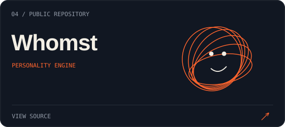</a>

A playful personality engine. Vector-based scoring, shareable results and dynamic social images.

Next.js · TypeScript · PostgreSQL · Prisma · Redis

<a href="https://github.com/Farazhaghgoo/whomst"><strong>Explore Whomst ↗</strong></a>
</td>
<td width="50%" valign="top">
<a href="https://github.com/Farazhaghgoo/financeApp">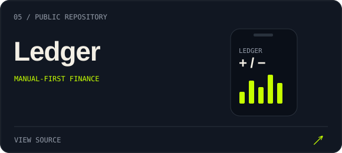</a>

Money tracking for real life: cash spending, peer transfers and optimistic, offline-tolerant writes.

React Native · Expo · Supabase · TanStack Query

<a href="https://github.com/Farazhaghgoo/financeApp"><strong>Explore Ledger ↗</strong></a>
</td>
</tr>
<tr>
<td width="50%" valign="top">
<a href="https://github.com/Farazhaghgoo/VeloCity">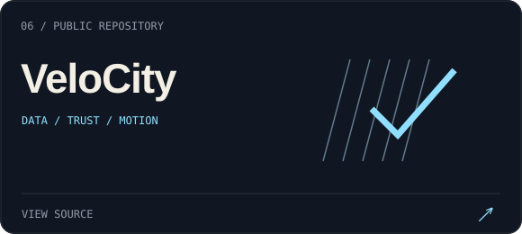</a>

A data-verification landing experience with expressive motion, responsive UI and a working waitlist backend.

Next.js · TypeScript · GSAP · Framer Motion

<a href="https://github.com/Farazhaghgoo/VeloCity"><strong>Explore VeloCity ↗</strong></a>
</td>
<td width="50%" valign="top">
<a href="https://github.com/Farazhaghgoo/CVai">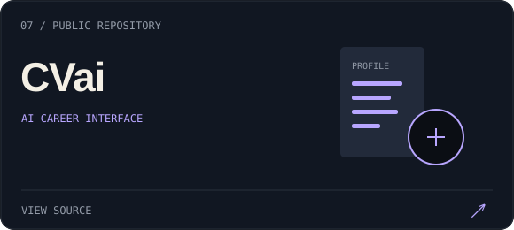</a>

A career-interface prototype exploring CV feedback, job matching and insights through mock-data interactions.

React · Vite · Tailwind CSS · SVG

<a href="https://github.com/Farazhaghgoo/CVai"><strong>Explore CVai ↗</strong></a>
</td>
</tr>
</table>

<picture>
  <source media="(prefers-color-scheme: dark)" srcset="assets/section-shiplog.svg">
  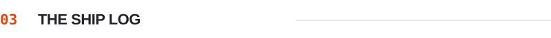
</picture>

<a href="https://github.com/Farazhaghgoo?tab=repositories">
  
</a>

Real commit messages from public repositories, at most four per project, refreshed by the included workflow.

<picture>
  <source media="(prefers-color-scheme: dark)" srcset="assets/section-toolkit.svg">
  
</picture>

  

  <strong>Web</strong> / React + Next.js &nbsp; · &nbsp; <strong>Mobile</strong> / React Native + Expo 
  <strong>Data</strong> / PostgreSQL + Supabase &nbsp; · &nbsp; <strong>Motion</strong> / GSAP + Framer Motion 
  <strong>Realtime</strong> / Node.js + WebSocket &nbsp; · &nbsp; <strong>Edge</strong> / Cloudflare Workers 
  <strong>Testing</strong> / Vitest + Playwright

<strong>What keeps me curious</strong>

AI-native products, human–computer interaction, product architecture, and the moment a strange idea becomes something useful.

<strong>Understand → Build → Refine → Ship → Repeat.</strong>

<picture>
  <source media="(prefers-color-scheme: dark)" srcset="assets/section-activity.svg">
  
</picture>

<a href="https://github.com/Farazhaghgoo?tab=overview">
  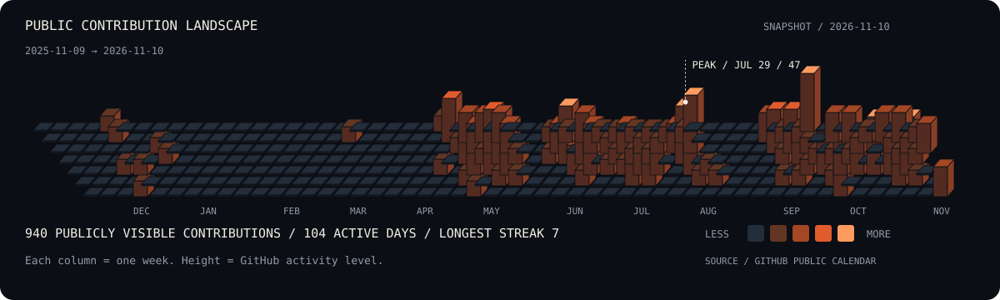
</a>

A public snapshot, refreshed by the included workflow. My professional work happens in private repositories too.

Faraz Haghgoo / Turin, Italy &nbsp; · &nbsp; <a href="https://github.com/Farazhaghgoo">GitHub</a> &nbsp; · &nbsp; <a href="https://www.linkedin.com/in/faraz-haghgoo-6b4a64252">LinkedIn</a>

