<picture>
  <source media="(prefers-reduced-motion: reduce)" srcset="assets/hero-static.svg">
  
</picture>

<picture>
  <source media="(prefers-reduced-motion: reduce)" srcset="assets/typing-static.svg">
  
</picture>

  
  &nbsp;
  
  &nbsp;
  


  <a href="#professional-work">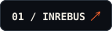</a>
  
  <a href="#control-room">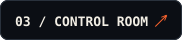</a>
  

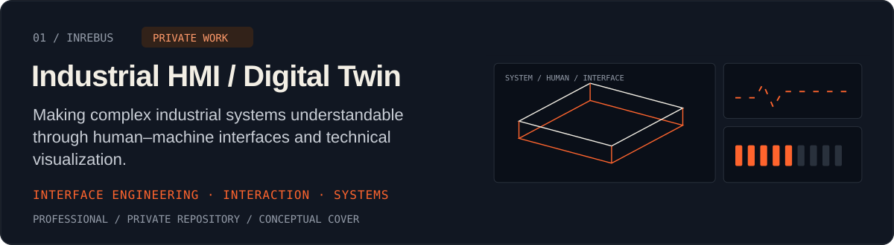

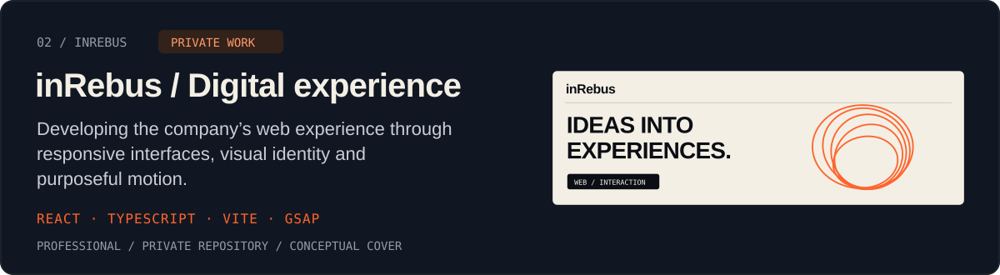

<a href="https://hamiyami.com"></a>

<a href="https://uniexamer.com"></a>

<a href="https://vibeassist.assist365.app"></a>

  
  
  
  


<a href="https://github.com/Farazhaghgoo?tab=repositories">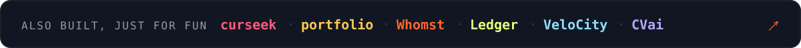</a>

<a href="https://github.com/Farazhaghgoo?tab=overview">
  
</a>

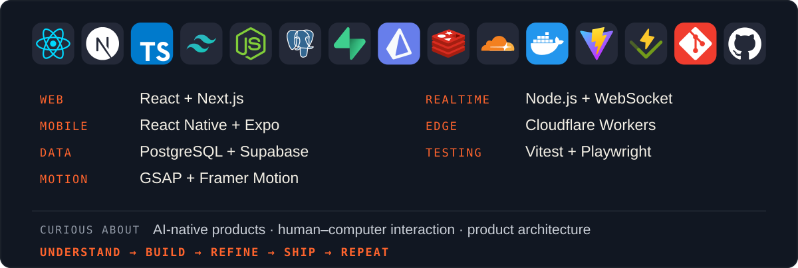

<a href="https://www.linkedin.com/in/faraz-haghgoo-6b4a64252">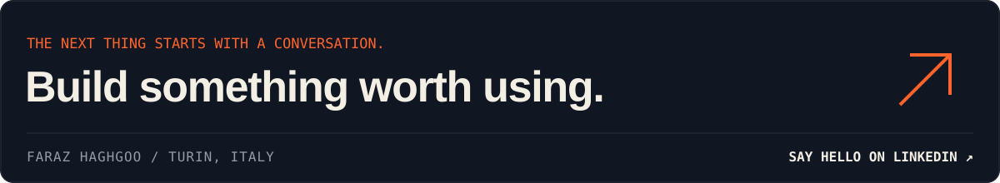</a>
